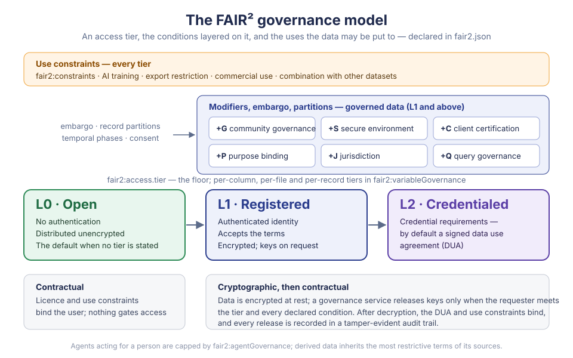

# Governance Model

FAIR² is FAIR, made **AI-ready** and **responsible**: FAIR + AIR + RAI. The
governance model is the responsible part made operational. It states how a
dataset may be accessed, used, combined and derived — by people and by AI
agents acting for them — and it is designed so that, for governed data, the
statement is enforced rather than advisory.

A dataset's governance is declared in its `fair2.json`, in the optional
[governance blocks](governance.md), and enforced by **governance services**:
systems that encrypt governed data, decide every request against the declared
terms, release decryption keys only when they are met, and record what they
released. This page describes the model; [Governance blocks](governance.md)
defines how a `fair2.json` states it.



---

## Ten primitives

A dataset's governance is fully described by which of ten primitives are active
and how each is set. They are orthogonal: any combination is valid, and each
adds a requirement without weakening another.

| Primitive | Controls | Declared in |
|---|---|---|
| **Access tier** — L0, L1, L2 | Who may obtain the data at all: anyone, a registered identity, or a credentialed one | `fair2:access.tier` |
| **+G** Community governance | A community's approval before access — the CARE principle of Authority to Control | `fair2:access.communityGovernance` |
| **+S** Secure environment | Where the data may be processed: a secure human environment, compute-to-data, an attested enclave | `fair2:access.environment` |
| **+C** Client certification | Which software may receive the data | `fair2:access.clientCertification` |
| **+P** Purpose binding | Why the data may be used, as declared or verified purposes | `fair2:access.purposeBinding` |
| **+J** Jurisdiction | Where processing may take place | `fair2:access.jurisdiction` |
| **+Q** Query governance | How the data may be queried and linked: granularity, group sizes, joins with other data | `fair2:access.queryGovernance` |
| **Use constraints** | What the data may be used for: AI training, export, commercial use, combination | `fair2:constraints` |
| **Embargo** | When governed data is released | `fair2:embargo` |
| **Record partitions** | Which records a stricter tier applies to | `fair2:variableGovernance.partitions` |

Beyond them, the model governs **AI agents** (`fair2:agentGovernance`),
**participant consent** (`fair2:consentGovernance`), **Indigenous data
sovereignty** (`fair2:indigenousGovernance`) and **access that changes over
time** (`fair2:temporalGovernance`).

### Three tiers

The tiers form a ladder, aligned with established controlled-access models
such as those of GA4GH and PhysioNet.

| Tier | Requires | The data |
|---|---|---|
| **L0 — Open** | Nothing | Distributed unencrypted. Its terms — licence, citation, use constraints — bind the user but do not gate access. |
| **L1 — Registered** | An authenticated identity and acceptance of the terms | Encrypted; keys released on request. |
| **L2 — Credentialed** | The steward's credential requirements: by default a signed data use agreement (DUA), optionally institutional affiliation, ethics training, or a stronger identity assurance | Encrypted; keys released to credentialed requesters. |

The dataset's tier is a **floor**: a requester below it receives nothing, and
one above it reaches every part of the dataset tagged at or below their own
standing. A single dataset can therefore **mix tiers** — summary columns open
at L0, diagnoses at L1, identifiers at L2; one directory of images at L2; the
records of minors at L2 while adults' are at L1.

**No tier means L0.** A dataset that declares no governance, or no tier, is
open. A governance service requires the tier to be stated before it publishes a
dataset, so that open access is a decision rather than an omission.

### Common compositions

| Composition | For example |
|---|---|
| L0 | Open data under a licence |
| L1 | Registered access: users identify themselves and accept the terms |
| L2 | Credentialed access under a data use agreement |
| L1 + G | Registered access with community approval — Indigenous health data |
| L2 + S | Credentialed access inside a trusted research environment — clinical trial data |
| L2 + C | Credentialed access through approved software only |
| L1 + P | Registered access for stated purposes — "academic research" or "public health" |
| L2 + J | Credentialed access processed only within the EU |
| L1 + Q | Registered access to aggregates; individual records at L2 |
| L2 + G + S + C + P + J + Q | Every safeguard at once |

---

## How a request is decided

A governance service evaluates a request in a fixed order and stops at the
first requirement that is not met, so a refusal names exactly what is missing.

1. **Withdrawn or erased?** A retracted or tombstoned dataset is refused.
2. **Embargoed?** Governed data is withheld until the embargo date.
3. **Which phase?** Temporal governance may change the tier in force.
4. **Open?** If everything requested is L0, it is granted here.
5. **Use constraints.** A request to train AI, or for commercial use, that the
   constraints prohibit is refused.
6. **Tier and identity.** The requester must reach the tier, present the
   required credentials and identity assurance, and come from an accepted
   identity provider.
7. **Modifiers.** Community approval (+G) and governance-body or
   cultural-protocol clearance, then the environment (+S), the client's
   certificate (+C), the purposes (+P) and the jurisdiction (+J). Purposes can
   narrow the grant to the columns they authorise; partitions narrow it to the
   records the requester's tier reaches.
8. **Agents.** An AI agent needs a verified delegation from a person, and is
   capped at its ceiling tier; a dataset may refuse agents altogether.
9. **Queries.** Query governance (+Q) may refuse queries at the granted tier.
10. **Consent.** Outstanding consent withdrawals can block the release, or
    exclude the withdrawn records.

The outcome is **granted** — with the tier granted, the constraints that apply
and, where purposes limit it, the columns released — or a refusal stating what
is required: credentials, governance approval, an environment, a certificate, a
purpose, a jurisdiction, or a date.

---

## What is enforced, and how

Governance holds in different ways at different points, and the model is
explicit about which.

| | Enforced by |
|---|---|
| **L0 data** | The licence and use constraints — contractually. Nothing gates access. |
| **Access to L1 and L2 data** | Cryptography. The data is encrypted at rest; decryption keys are released only after every requirement is met, and only for the parts the requester may reach. Without keys the data is inert, wherever it is stored — on a governance service, in a public repository, on a shipped drive. |
| **Tier separation, purpose-scoped columns, embargo, community veto** | Key release: the keys for what a requester may not reach are never sent. |
| **Use after decryption** — purpose, AI training, export, redistribution | The data use agreement and use constraints, contractually; a certified client (+C) adds an accountability loop, since its certificate can be revoked. |
| **Derived data** | Inheritance: a derived dataset carries the most restrictive terms of all its sources. |
| **What happened** | A tamper-evident, hash-chained audit trail of every governance action and key release. |

Cryptographic enforcement ends at decryption. What a requester does with data
they hold is bound by agreement, not by mathematics — the model states this
rather than claiming more.

Keys can be held by a network of independent custodians, a threshold of whom
must take part in every release, so that no single party — not even the service
— can release them alone. With community governance, the community holds a
share of that authority, which makes its veto technical rather than nominal.

---

## Derived data

When data is transformed, aggregated or combined, its governance travels with
it. A derived dataset inherits, for each constraint, the most restrictive value
among its sources:

| Constraint | From least to most restrictive |
|---|---|
| AI training | `allowed` → `restrictedWithConditions` → `prohibited` |
| Commercial use | `allowed` → `nonCommercialOnly` |
| Export | `none` → `aggregated-only` → `anonymized-only` → `derived-parameters-only` |
| Query granularity | `individual` → `grouped` → `aggregated` → `none` |
| Purpose requirement | `none` → `declared` → `verified` |
| Linkage | `unrestricted` → `sameStudy` → `approved` → `prohibited` |

Allowed purposes and accepted jurisdictions narrow to those **all** sources
accept; prohibited purposes accumulate from **any** source. Combining datasets
is checked first against each one's combination policy.

---

## Lifecycle and signatures

A governance declaration has a lifecycle:

```
draft → signed by the author → countersigned by the publisher → published
                                                   published ⇄ retracted
                                                   published → tombstoned
```

- **Published** governance is signed twice — by the author and by the
  publisher — with [W3C Data Integrity](https://www.w3.org/TR/vc-data-integrity/)
  proofs, so the terms are tamper-evident and attributable. It cannot be changed
  in place: new terms are a new version, which supersedes the old one for
  future requests.
- **Retracted** data is withdrawn by its author; access to governed data stops.
  Retraction can be reversed.
- **Tombstoned** data has been erased, for instance on a GDPR request: the
  descriptive metadata is stripped, access to governed data is refused, and its
  keys can be destroyed. Data that may need erasing should be at L1 or above —
  open copies already downloaded cannot be recalled.

---

## AI agents

An AI agent acting for a person is governed in its own right. Its access is
capped at a **ceiling tier**, whatever its principal could reach; it needs a
verified delegation; and a dataset can limit how it works — directly, planning
only, planning with human approval, algorithmic agents only — or refuse agents
altogether. Only the refusal is enforced at key release; the other policies
bind the software that runs the agent.

---

## FAIR and CARE

The model supports, rather than certifies, the FAIR and CARE principles: it
provides the mechanisms; stewards, communities and services supply the
decisions.

| Principle | What the model provides |
|---|---|
| **Findable** | Governance metadata that travels with the dataset's identifier; version history |
| **Accessible** | Conditional access through open protocols — FAIR permits authentication and authorisation; metadata stays public while governed data is withheld |
| **Interoperable** | A shared, machine-readable governance representation; W3C DPV purposes; an [ODRL export](../integration/odrl-policy.md) |
| **Reusable** | Licence, use constraints and agreements stating the conditions of reuse; signed provenance of the terms |
| **Collective benefit** | Community review of proposed access (+G); permitted and prohibited purposes (+P); agreement terms for benefit-sharing |
| **Authority to control** | Community approval with a technical veto; named governance bodies; cultural protocols such as seasonal restrictions |
| **Responsibility** | Signed declarations naming accountable parties; audit trails and lineage of downstream use |
| **Ethics** | Verified purposes, ethics approval, AI-use restrictions, consent controls |

A community-governed dataset can expose community-approved discovery metadata
while its sensitive data stays at L1 or L2 under +G and +P, its reuse recorded
through lineage and audit. Communities decide whether metadata itself reveals
sensitive knowledge; being discoverable never authorises publishing everything.

---

## Scope of this specification

This specification defines what a `fair2.json` declares and how a reader must
interpret it — [Governance blocks](governance.md) — and nothing about how a
service implements enforcement: key hierarchies, custody, signing ceremonies,
audit formats and protocols are the governance service's. A service documents
which of the guarantees above it provides, and under which deployment.

This page follows the FAIR² governance model version 1.16.
